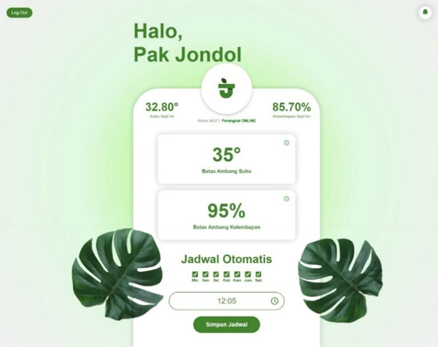
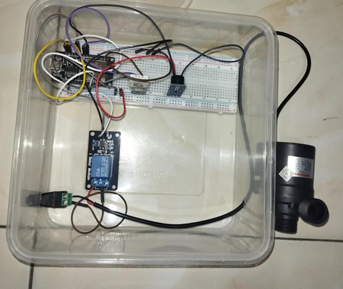
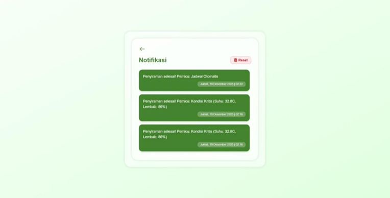

# 🌱 Smart Garden - Proyek IoT Kelompok 3


**Smart Garden IoT (Kelompok 3)** adalah sistem monitoring dan penyiraman tanaman otomatis berbasis *Internet of Things* (IoT). Proyek ini dikembangkan untuk memantau kondisi lingkungan tanaman (Suhu & Kelembapan) secara *real-time* serta mengendalikan pompa air berdasarkan logika sensor maupun jadwal yang telah ditentukan.

Sistem ini dibangun menggunakan **Laravel 12** sebagai antarmuka web dan mikrokontroler **ESP32** sebagai pengendali perangkat keras.

---

## 📸 Antarmuka & Dokumentasi

### 1. Dashboard Monitoring
Memantau kondisi tanaman secara real-time dengan indikator status perangkat (Online/Offline).


### 2. Implementasi Hardware
Rangkaian ESP32, Sensor DHT22, Relay, dan Pompa dalam wadah proteksi.


### 3. Fitur Kontrol & Notifikasi
Pengaturan ambang batas (*threshold*), jadwal mingguan, dan riwayat penyiraman.
| Modal Setting Threshold | Notifikasi & Riwayat |
|:-----------------------:|:--------------------:|
|  |  |

---

## 🔥 Fitur Utama

### 🌐 Web System (Laravel 12)
- **Real-time Monitoring:** Data suhu dan kelembapan diperbarui secara berkala via protokol MQTT/HTTP.
- **Auto-Detection Status:** Sistem mendeteksi otomatis jika alat mati atau putus koneksi (Indikator Offline).
- **Flexible Threshold:** Pengguna bisa mengubah batas pemicu (Suhu Panas / Tanah Kering) langsung dari antarmuka web tanpa coding ulang.
- **Smart Scheduling:** Jadwal penyiraman otomatis berbasis hari dan jam.
- **Log History:** Mencatat setiap aktivitas penyiraman beserta pemicunya (Sensor/Jadwal) dengan fitur *Reset Data*.

### 🤖 Hardware Logic (ESP32)
- **Compound Logic:** Penyiraman otomatis terjadi jika kondisi kritis terpenuhi (**Suhu > Batas** DAN **Lembab < Batas**).
- **State Memory:** Mengingat pemicu penyiraman terakhir untuk pelaporan data yang akurat.
- **Fail-Safe Timer:** Proteksi durasi penyiraman agar pompa tidak menyala terus-menerus.

---

## 🛠️ Spesifikasi Teknis

### Perangkat Lunak (*Software Stack*)
- **Framework:** Laravel 12 (PHP 8.2+)
- **Database:** MySQL / MariaDB
- **Frontend:** Blade Templating, Tailwind CSS, Vite
- **Web Server:** Apache / Nginx (XAMPP / Laragon / aaPanel)

### Perangkat Keras (*Hardware Pinout*)
Mapping pin pada **ESP32 DevKit V1**:

| Komponen | Tipe | Pin GPIO | Keterangan |
| :--- | :--- | :--- | :--- |
| **DHT22** | Input | `GPIO 26` | Sensor Suhu & Kelembapan |
| **Relay Module** | Output | `GPIO 14` | Trigger Pompa Air (Active Low) |

---

## 🚀 Cara Instalasi & Menjalankan (Web Server)

Ikuti langkah-langkah berikut untuk menjalankan server lokal:

1. **Clone Repository**
   ```bash
   git clone https://github.com/naflaasriyah16-blip/project_iot_kel3.git
   cd project_iot_kel3
   ```

2. **Install Dependencies**
   ```bash
   composer install
   npm install
   ```

3. **Konfigurasi Environment**
   Salin file `.env.example` menjadi `.env` dan sesuaikan pengaturan database:
   ```bash
   copy .env.example .env
   php artisan key:generate
   ```
   *Sesuaikan `DB_DATABASE`, `DB_USERNAME`, dan `DB_PASSWORD` di dalam file `.env`.*

4. **Build Frontend Assets**
   ```bash
   npm run build
   ```

5. **Migrasi Database**
   ```bash
   php artisan migrate
   ```

6. **Jalankan Server Lokal**
   ```bash
   php artisan serve
   ```
   Akses aplikasi di browser: **`http://localhost:8000`**

---

## 🔌 Implementasi Hardware (ESP32 Firmware)

Kode sumber lengkap firmware mikrokontroler dapat dilihat di folder [`/hardware`](./hardware).

### ✨ Fitur Unggulan Firmware
1. **Dynamic WiFi Connect (`WiFiManager`):** Tidak perlu *hardcode* SSID/Password di kode program. Jika koneksi terputus, alat menyebarkan Hotspot untuk konfigurasi ulang via HP/Laptop.
2. **OTA Control (MQTT):** Menerima perintah *threshold* dan jadwal baru secara *real-time* tanpa perlu restart mikrokontroler.
3. **Fail-Safe Logic:** Sistem proteksi pompa otomatis mati jika koneksi terputus atau batas waktu penyiraman terlampaui.
4. **Dual Protocol:** Menggunakan **MQTT** untuk transmisi cepat dan **HTTP POST** untuk pencatatan riwayat ke Laravel.

### ⚙️ Konfigurasi Awal di Arduino IDE
Sebelum melakukan upload firmware ke ESP32, pastikan library berikut sudah terpasang:
- `WiFiManager` by tzapu
- `PubSubClient` (MQTT)
- `DHT sensor library`
- `Adafruit Unified Sensor`

### 📝 Snippet Konfigurasi
Sesuaikan variabel endpoint API dan broker MQTT di file [`hardware/code.ino`](hardware/code.ino):
```cpp
// === KONFIGURASI API LARAVEL ===
String serverName = "http://IP-SERVER-KAMU:8000/api/simpan-notif";

// === MQTT BROKER ===
const char* mqtt_server = "broker.emqx.io";
```

### 📶 Cara Setting WiFi Pertama Kali (Tanpa Coding)
1. Saat ESP32 pertama kali dinyalakan (atau reset WiFi), ESP32 akan menyebarkan Hotspot bernama `IoT-Penyiraman-Config`.
2. Hubungkan HP atau Laptop ke jaringan WiFi tersebut.
3. Halaman "Configure WiFi" akan otomatis terbuka di browser.
4. Pilih WiFi yang ingin digunakan dan masukkan kata sandi.
5. Klik **Save**, alat akan restart dan terhubung otomatis.
6. *Untuk mereset konfigurasi WiFi:* Tekan tombol **BOOT (Pin 0)** pada modul ESP32.

---

## 👥 Tim Pengembang (Kelompok 3)

| No | Nama Anggota | NIM | Peran / Tugas |
|:--:|:-------------|:---:|:--------------|
| 1 | *[Nama Anggota 1]* | - | *[Peran / Tugas]* |
| 2 | *[Nama Anggota 2]* | - | *[Peran / Tugas]* |
| 3 | *[Nama Anggota 3]* | - | *[Peran / Tugas]* |
| 4 | *[Nama Anggota 4]* | - | *[Peran / Tugas]* |

**Program Studi D3 Teknik Informatika**  
**Politeknik Negeri Indramayu (Polindra)**  
*Mata Kuliah: Proyek 2 (Implementasi Laravel dan Integrasi dengan IoT)*
